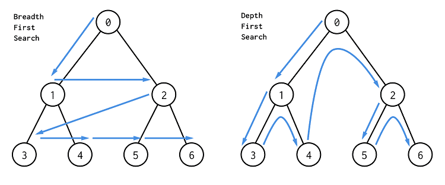

# Breadth-first search(BFS)
Граф дээр хайлт хийх, алхах хамгийн энгийн бөгөөд түгээмэл ашиглагддаг алгоритм.
BFS нь очоогүй байгаа оройнууд дээр олсон дарааллаараа очдог алгоритм.

Доорхи байдлаар ажиллана.
1. Графын эхлэлийн цэгийг сонгож queue рүү хийнэ.
2. queue дотроос хамгийн эхний оройг аваад, тухайн оройтой холбоотой байгаа, очоогүй/queue-д хийгээгүй байгаа оройг queue-д хийнэ.
3. queue-г хоосон болтол нь 2дох үйлдлийг давтана. 



👉 **Алхам алхмаар анимэйшнээр харах:** [BFS анимэйшн](https://raw.githack.com/khangai11/surgalt/main/html/bfs.html) (play, prev, next товчтой)

## Яаж програм бичих вэ?

Queue ашиглах
   1. Орой бүр queue-д орсон эсэхийг visited[N]-д хадгална. Дараа нь очих оройнуудаа queue<int> q-д хадгална.
   2. q-д эхлэлийн оройгоо нэмээд visited[start] = true болгоно.
   3. q-ийн хамгийн урд байгаа оройг (u гэе) аваад q-ээс хасна.
   4. u-тэй холбоотой, queue-д ороогүй орой (v гэе) бүрийн хувьд visited[v] = true болгоод q-д нэмнэ.
   5. q хоосон биш бол 3-р алхам руу буцна.
   ```cpp
   // n ширхэг оройтой граф өгөгдсөн гэж бодъё.
   vector<vector<int>> e(n);          // хөршүүдийн жагсаалт
   vector<bool> visited(n, false);    // queue-д орсон эсэх
   queue<int> q;
   int start = 0;                     // эхлэх орой
   q.push(start);
   visited[start] = true;
   while(!q.empty()){
       int u = q.front();             // хамгийн эхэнд орсон орой
       q.pop();
       cout << u << " ";
       for(auto v : e[u]){
           if(visited[v]) continue;   // өмнө нь орсон бол алгасна
           visited[v] = true;
           q.push(v);
       }
   }
   ```

## Дасгалууд

```
Дасгал 1:
0,1,2...,N-1 оройтой граф өгөгдөнө. Мөн M ширхэг ирмэг өгөгдөнө. Өгөгдсөн графыг 0 оройгоос эхлэн BFS хайлт хийж, тухайн дарааллаар нь хэвлэ.
Эхний мөрөнд N болон M тоо өгөгдөнө. Дараагын М мөр болгонд u,v гэсэн 2 тоо өгөгдөх ба энэ нь u,v 2 орой ирмэгээр холбогдсонг илтгэнэ.
Оролт:
N M
u[1] v[1]
...
u[M] v[M]

оролт1:
5 6
0 1
0 3
0 4
3 4
3 2
2 2
гаралт1:
0 1 3 4 2
(1,3,4 гарч ирэх дараалал нь өөр байж болно.)

оролт2:
7 6
0 1 
1 2
2 3 
3 4
4 5
5 6

гаралт2:
0 1 2 3 4 5 6
```

```
Дасгал 2:
0,1,2...,N-1 оройтой чиглэлгүй граф өгөгдөнө. Мөн M ширхэг ирмэг өгөгдөнө. Орой болгоны хувьд 0 орой хүртэлхи хамгийн богино замын уртыг ол.Богино зам гэдэг нь 0 орой руу очихдоо хамгийн багадаа хэдэн ирмэг дамжиж очих тоотой тэнцүү.
Эхний мөрөнд N болон M тоо өгөгдөнө. Дараагын М мөр болгонд u,v гэсэн 2 тоо өгөгдөх ба энэ нь u,v 2 орой ирмэгээр холбогдсонг илтгэнэ.
Оролт:
N M
u[1] v[1]
...
u[M] v[M]

оролт1:
5 6
0 1
0 3
0 4
3 4
3 2
2 2

гаралт1:
0 1 2 1 1

оролт2:
5 5
0 1
2 1
1 3
3 2
3 4

гаралт2:
0 1 2 2 3

```

```
Дасгал 3:
0,1,2...,N-1 оройтой чиглэлтэй граф өгөгдөнө. Мөн M ширхэг ирмэг өгөгдөнө. Орой болгоны хувьд N-1 орой хүртэлхи хамгийн богино замын уртыг ол.Богино зам гэдэг нь N-1 орой руу очихдоо хамгийн багадаа хэдэн ирмэг дамжиж очих тоотой тэнцүү.
Эхний мөрөнд N болон M тоо өгөгдөнө. Дараагын М мөр болгонд u,v гэсэн 2 тоо өгөгдөх ба энэ нь u-аас v-рүү чиглэсэн ирмэгээр холбогдсонг илтгэнэ.
Оролт:
N M
u[1] v[1]
...
u[M] v[M]

оролт1:
6 9
4 0
0 1
2 1
5 1
3 2 
1 3
3 4
5 4
1 5

гаралт1:
2 1 2 3 3 0

оролт2:
5 6
4 0
3 4
2 3
1 2
0 1
0 2

гаралт2:
3 3 2 1 0
```


```
Дасгал 4:
0,1,2...,N-1 оройтой чиглэлгүй граф өгөгдөнө. Мөн M ширхэг ирмэг өгөгдөнө. Уг граф-д цикл байвал YES, байхгүй бол NO гэж хэвлэ.
Эхний мөрөнд N болон M тоо өгөгдөнө. Дараагын М мөр болгонд u,v гэсэн 2 тоо өгөгдөх ба энэ нь u,v 2 орой ирмэгээр холбогдсонг илтгэнэ.
Оролт:
N M
u[1] v[1]
...
u[M] v[M]

оролт1:
5 4
0 4
4 3
3 2
1 2

гаралт1:
NO

оролт2:
5 4
4 0
0 3
2 0
1 2

гаралт2:
NO

оролт3:
5 4
0 1
1 4
4 0
2 0

гаралт3:
YES
```