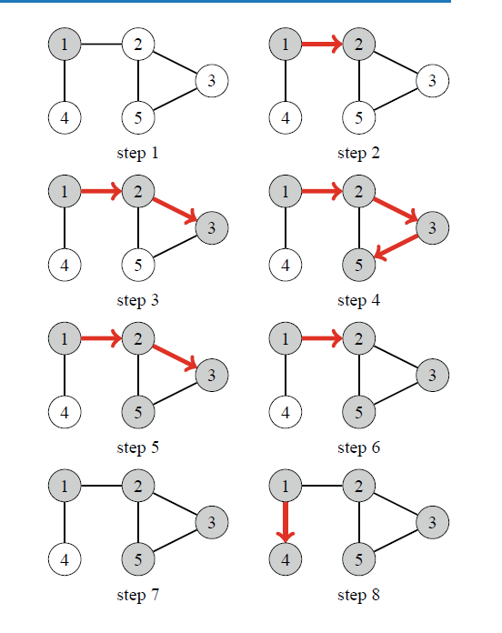

# Depth-first search(DFS)
Граф дээр хайлт хийх, алхах хамгийн энгийн бөгөөд түгээмэл ашиглагддаг алгоритм.
DFS нь очоогүй байгаа элемент олдох л юм бол хамгийн түрүүнд тэр орой дээрээ очдог алгоритм.

Доорхи байдлаар ажиллана.
1. Графын эхлэлийн цэгийг сонгоно.
2. Одоо байгаа оройтой холбоотой, очоогүй байгаа орой байвал тэр орой луу шилжинэ.
3. Одоо байгаа оройтой холбоотой оройнуудад бүгдэд нь очсон бол, өмнөх орой луугаа шилжинэ.
4. Эхлэлийн цэгтэй холбоотой бүх орой дээр очсон бол дуусгана.



👉 **Алхам алхмаар анимэйшнээр харах:** [DFS анимэйшн](https://raw.githack.com/khangai11/surgalt/main/html/dfs.html) (stack болон рекурсив хоёр арга, play, prev, next товчтой)

Яаж програм бичих вэ
1. Stack ашиглах
   1. Орой бүр дээр очсон эсэхээ visited[N]-д хадгална. Дараа нь очих оройнуудаа stack<int> s-д хадгална.
   2. s-д эхлэлийн оройгоо нэмнэ.
   3. s-д хамгийн сүүлд нэмсэн оройг (u гэе) аваад s-ээс хасна.
   4. u дээр аль хэдийн очсон бол 6-р алхам руу шилжинэ. Очоогүй бол visited[u] = true болгоно.
   5. u-тэй холбоотой, очоогүй орой (v гэе) бүрийг s-д нэмнэ. (Нэг орой s-д хэд хэд орж болно.)
   6. s хоосон биш бол 3-р алхам руу буцна.
   ```cpp
   // n ширхэг оройтой граф өгөгдсөн гэж бодъё.
   vector<vector<int>> e(n);          // хөршүүдийн жагсаалт
   vector<bool> visited(n, false);    // очсон эсэх
   stack<int> s;
   int start = 0;                     // эхлэх орой
   s.push(start);
   while(!s.empty()){
       int u = s.top();               // хамгийн сүүлд орсон орой
       s.pop();
       if(visited[u]) continue;       // очсон бол алгасна
       visited[u] = true;
       cout << u << " ";
       for(auto v : e[u]){
           if(!visited[v]) s.push(v); // очоогүй хөршүүдийг хийнэ
       }
   }
   ```
2. Recursive function ашиглах
   1. stack ашиглах аргатай адилхан графын хөршүүдийн жагсаалт e болон очсон эсэхийг тэмдэглэх visited ашиглана.
   2. dfs(u) гэсэн функц тодорхойльё. Энэ функц нь u-тэй холбоотой очоогүй байгаа оройнууд дээр очдог функц гэе.
   3. dfs(эхлэлийн цэг) гэхэд бүх орой дээр очиж чадна.
   ```cpp
   void dfs(int u){
       if(visited[u]) return;
       visited[u] = true;
       cout << u << " ";
       for(auto v : e[u]){
           if(visited[v]) continue;   // очсон бол алгасна
           dfs(v);                    // v руу гүнзгийрнэ
       }
   }                                  // бүх хөршийг үзсэн -> буцна
   // main дотор: dfs(0);
   ```
