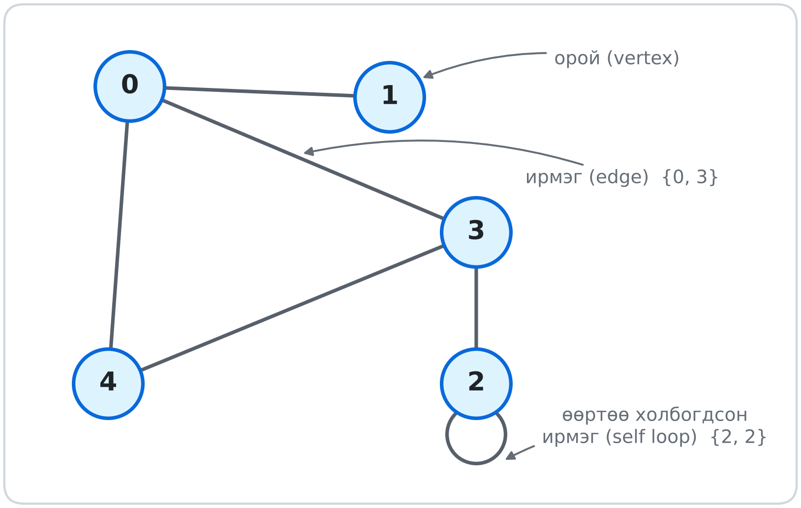
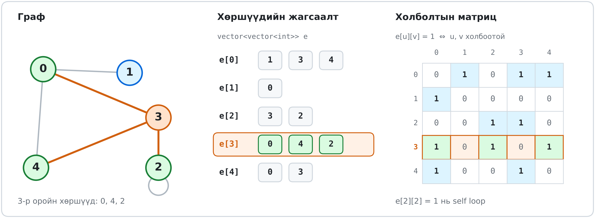
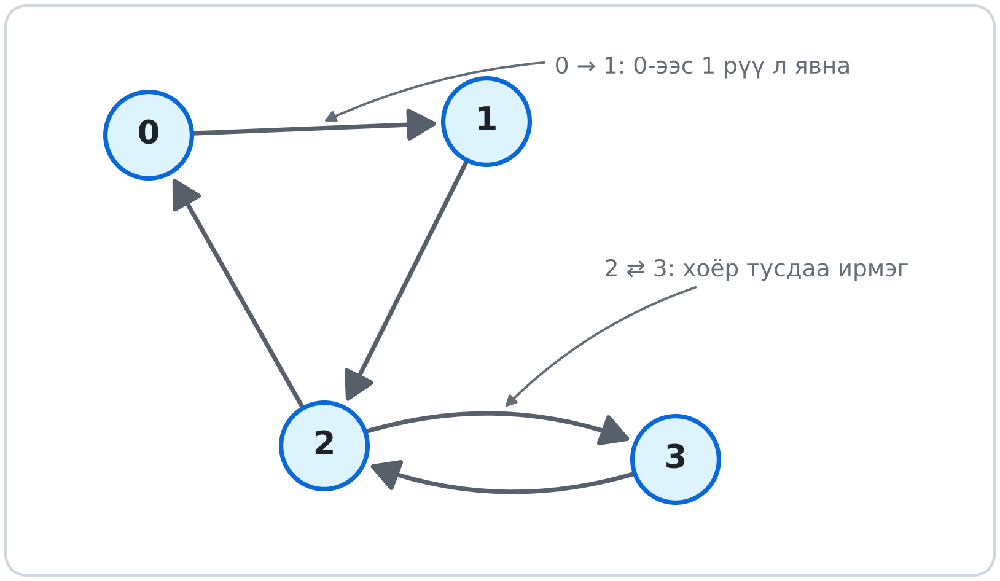
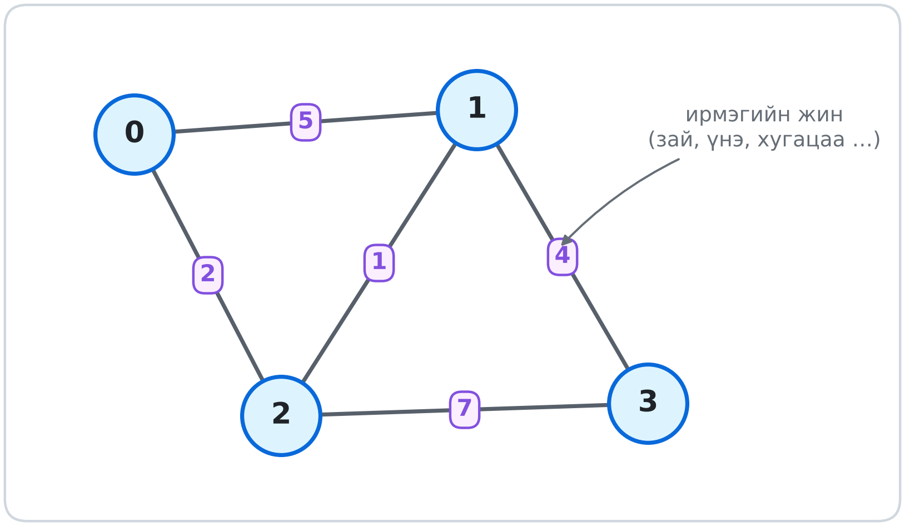
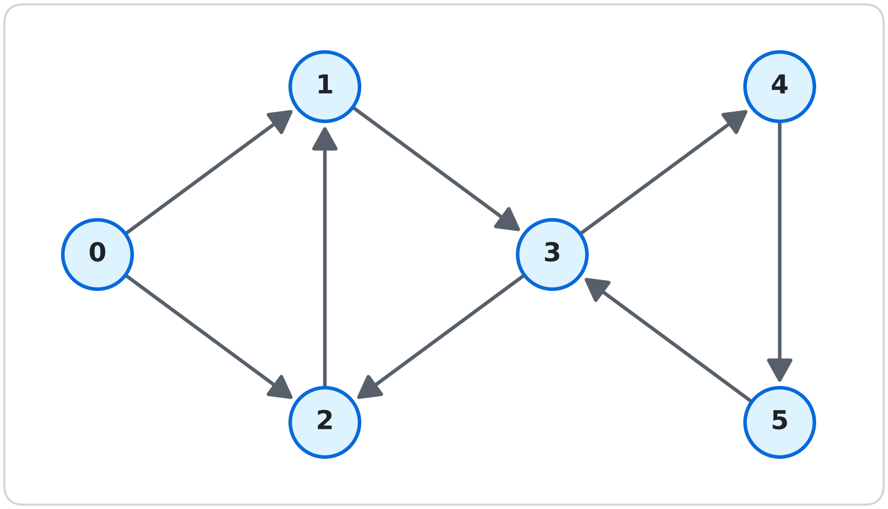
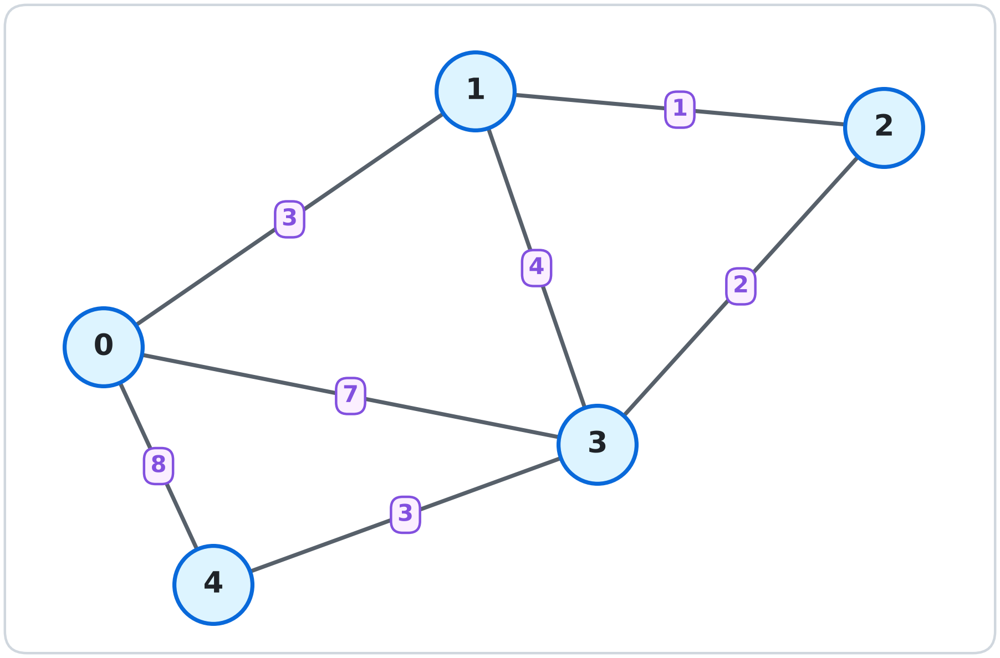

# Graph

Граф нь G = {V,E}-ээр тодорхойлогдоно. V нь граф дотор байгаа оройн олонлог, E нь тэдгээр оройг холбосон ирмэгүүдийн олонлог.


Дээрхи графын хувьд 
V = {0,1,2,3,4}
E = \{\{0,1\},\{0,3\},\{0,4\},\{2,3\},\{3,4\},\{2,2\}\}

Графийг програм дээр дүрслэх, хадгалахдаа ихэвчлэн 2 төрлийн аргаар хадгалдаг.



1. Хөршүүдийн жагсаалт(Adjacency-list representation)
u оройн хувьд u-тай холбоотой бүх оройг E[u] дотор хадгалах.Өөрөөр хэлбэл E[u] вектор(set,map,vector-ч байж болно.) дотор u-тай хөрш бүх оройнуудыг хадгална. E нь 2 хэмжээст вектор гэсэн үг.
Жишээ нь дээрхи граф нь доорхи хэлбэртэй болно.
```cpp
vector<vector<int>> e = {
    {1,3,4},  // 0-тэй холбоотой оройнууд
    {0},      // 1-тэй холбоотой оройнууд
    {3,2},    // 2-той холбоотой оройнууд
    {0,4,2},  // 3-тай холбоотой оройнууд
    {0,3}     // 4-тэй холбоотой оройнууд
};
```
Энэ хэлбэр нь граф нь сийрэг(ирмэгийн тоо нь бага) үед илүү ашигтай ба ихэнхи тохиолдолд энэ аргыг ашиглах нь илүү үр дүнтэй байдаг.

2. холболтын матриц(Adjacency-matrix representation)
|V|=n үед n * n хэмжээтэй 2D вектор болох E дотор бүх ирмэгийг хадгална. Хадгалахдаа u,v 2 оройн хоорондох ирмэгийн мэдээлэл нь e[u][v] болон e[v][u] дотор хадгална.
Жишээ нь дээрхи граф нь доорхи хэлбэртэй болно.
```cpp
//жишээ нь холбоотой оройг 1-ээр, холбоогүй бол 0-ээр тэмдэглэв.
vector<vector<int>> e = {
    {0,1,0,1,1},
    {1,0,0,0,0},
    {0,0,1,1,0},
    {1,0,1,0,1},
    {1,0,0,1,0}
};
```
Энэ хэлбэр нь граф нь шигүү (ирмэгийн тоо нь |V|^2-д ойролцоо) үед ашиглавал зүгээр.

Графын ирмэгүүд нь дараах шинж чанартай байдаг графууд түгээмэл ашиглагддаг.
* чиглэлтэй эсэх
  * чиглэлгүй(undirected graph,дээрхи граф нь энэ төрөл)
  * чиглэлтэй ирмэг(directed graph)

* жинтэй эсэх
  * жинтэй (weighted graphs)

  * өөртэйгөө холбогдсон(self loop, хамгийн эхний жишээн дээр {2,2} ирмэг)

## Оролтоос граф унших

Бодлогод граф ихэвчлэн ингэж өгөгдөнө: эхний мөрөнд оройн тоо N, ирмэгийн тоо M, дараагийн M мөр бүрт нэг ирмэг.

**1. Чиглэлгүй граф.** u, v ирмэгээр хоёр тийшээ явж болно. Тиймээс хоёулангийнх нь жагсаалтад нэмнэ.
```cpp
int n, m;
cin >> n >> m;
vector<vector<int>> e(n);
for(int i = 0; i < m; i++){
    int u, v;
    cin >> u >> v;
    e[u].push_back(v);
    if(u != v) e[v].push_back(u);   // self loop бол нэг л удаа нэмнэ
}
```

**2. Чиглэлтэй граф.** u → v ирмэгээр зөвхөн u-аас v руу явна. Тиймээс зөвхөн `e[u]`-д нэмнэ.
```cpp
vector<vector<int>> e(n);
for(int i = 0; i < m; i++){
    int u, v;
    cin >> u >> v;
    e[u].push_back(v);              // e[v]-д нэмэхгүй
}
```
Дээрх чиглэлтэй графын хувьд: `e[0] = {1}`, `e[1] = {2}`, `e[2] = {0, 3}`, `e[3] = {2}`.

**3. Жинтэй граф.** Ирмэг бүрт `u v w` гэсэн 3 тоо өгөгдөнө (w нь жин). Хөрш бүрийг `{хөрш, жин}` гэсэн [pair](pair_tuple.md)-аар хадгална.
```cpp
vector<vector<pair<int,int>>> e(n);   // e[u] = { {v, w}, ... }
for(int i = 0; i < m; i++){
    int u, v, w;
    cin >> u >> v >> w;
    e[u].push_back({v, w});
    e[v].push_back({u, w});           // чиглэлтэй бол энэ мөрийг бичихгүй
}

// u оройн хөршүүдийг давтах
for(auto p : e[u]){
    int v = p.first;                  // хөрш
    int w = p.second;                 // ирмэгийн жин
}
```
Дээрх жинтэй графын оролт ба хадгалагдах байдал:
```
4 5
0 1 5
0 2 2
1 2 1
1 3 4
2 3 7

e[0] = { {1,5}, {2,2} }
e[1] = { {0,5}, {2,1}, {3,4} }
e[2] = { {0,2}, {1,1}, {3,7} }
e[3] = { {1,4}, {2,7} }
```

```
Дасгал 1:
0,1,2...,N-1 оройтой граф өгөгдөнө. Мөн M ширхэг ирмэг өгөгдөнө. өгөгдсөн графыг хөршүүдийн жагсаалт аргаар илэрхийлээд үр дүнг нь хэвлэ.
Эхний мөрөнд N болон M тоо өгөгдөнө. Дараагийн М мөр болгонд u,v гэсэн 2 тоо өгөгдөх ба энэ нь u,v 2 орой ирмэгээр холбогдсонг илтгэнэ.
u = v (өөртөө холбогдсон ирмэг, self loop) бол v-г u-ийн жагсаалтад нэг л удаа нэмнэ.
Орой бүрийн хөршүүдийг ирмэг өгөгдсөн дарааллаар хэвлэ.
Оролт:
N M
u[1] v[1]
...
u[M] v[M]

оролт1:
5 6
0 1
0 3
0 4
3 4
3 2
2 2
гаралт1:
1 3 4
0
3 2
0 4 2
0 3

оролт2:
7 6
0 1 
1 2
2 3 
3 4
4 5
5 6

гаралт2:
1
0 2
1 3
2 4
3 5
4 6
5
```

```
Дасгал 2:
0,1,2...,N-1 оройтой граф өгөгдөнө. Мөн M ширхэг ирмэг өгөгдөнө. өгөгдсөн графыг холболтын матриц аргаар илэрхийлээд үр дүнг нь хэвлэ.
Эхний мөрөнд N болон M тоо өгөгдөнө. Дараагийн М мөр болгонд u,v гэсэн 2 тоо өгөгдөх ба энэ нь u,v 2 орой ирмэгээр холбогдсонг илтгэнэ.
u = v (self loop) бол e[u][u] = 1 болно.
Оролт:
N M
u[1] v[1]
...
u[M] v[M]

оролт1:
5 6
0 1
0 3
0 4
3 4
3 2
2 2
гаралт1:
0 1 0 1 1
1 0 0 0 0
0 0 1 1 0
1 0 1 0 1
1 0 0 1 0

оролт2:
7 6
0 1 
1 2
2 3 
3 4
4 5
5 6

гаралт2:
0 1 0 0 0 0 0
1 0 1 0 0 0 0
0 1 0 1 0 0 0
0 0 1 0 1 0 0
0 0 0 1 0 1 0
0 0 0 0 1 0 1
0 0 0 0 0 1 0
```

Дасгал3:
Доорхи графыг хөршүүдийн жагсаалт аргаар илэрхийл.



Дасгал4:
Доорхи графыг хөршүүдийн жагсаалт аргаар илэрхийл.

