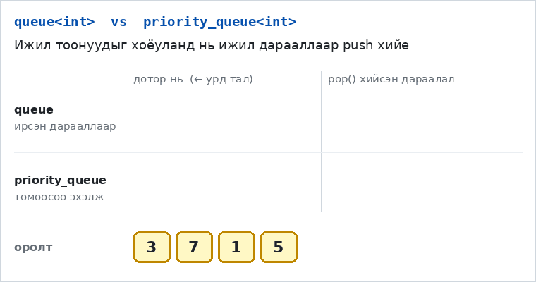
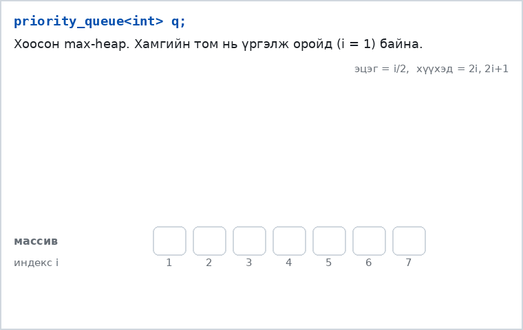
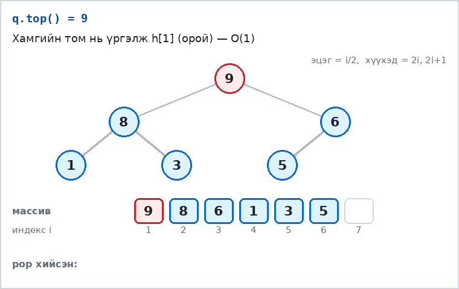
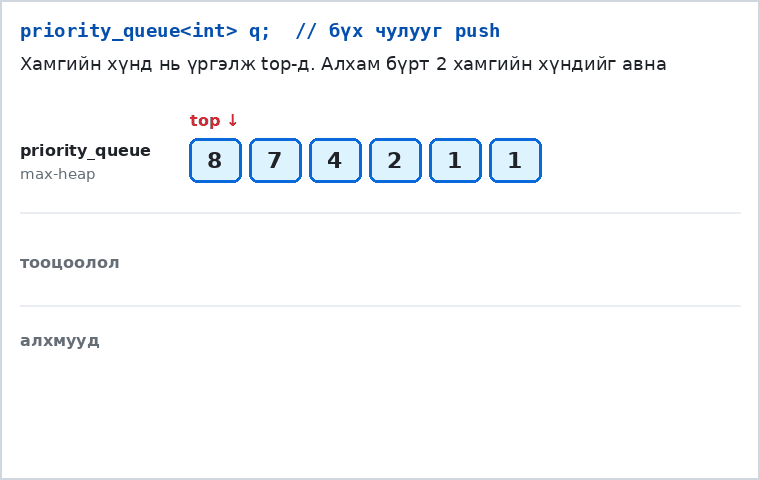
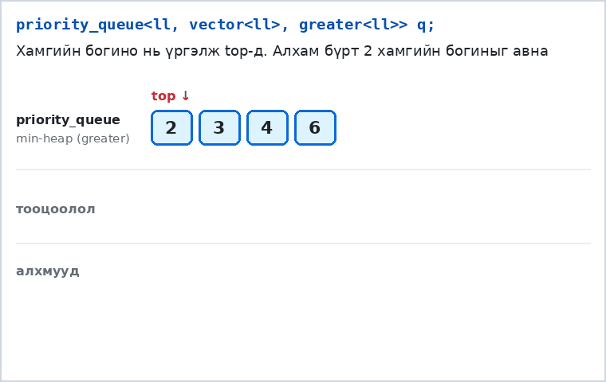

# stl::priority_queue

## 1. Priority queue гэж юу вэ?

Энгийн `queue`-д элементүүд **ирсэн дарааллаараа** гардаг (FIFO — эхэлж орсон нь эхэлж гарна).
`priority_queue`-д харин **хамгийн өндөр эрэмбэтэй** (анхдагчаар хамгийн **том**) элемент нь хэзээ орсноос үл хамааран түрүүлж гарна.

> Жишээ: Эмнэлгийн яаралтай тусламжид хэн эхэлж ирснээр биш, хэн хамгийн хүнд байгаагаар нь үзлэгт оруулдаг. Энэ бол priority queue.

Доорх анимэйшнд ижил `3 7 1 5` тоонуудыг хоёуланд нь push хийгээд, дараа нь pop хийж байна:



`priority_queue` нь `multiset`-тэй төстэй, гэхдээ balanced binary search tree биш **heap** бүтэц ашигладаг. Тиймээс:

| | `priority_queue` | `multiset` |
|---|---|---|
| Хамгийн томыг харах | O(1) | O(1) (`*prev(s.end())`) |
| Нэмэх / хамгийн томыг устгах | O(log n), **илүү хурдан** | O(log n), удаавтар |
| Дурын элемент хайх, устгах | ❌ боломжгүй | ✔ `find`, `erase` |
| Хамгийн бага, хамгийн том хоёуланг нь | ❌ зөвхөн нэг тал | ✔ |

**Дүрэм:** Зөвхөн "хамгийн томыг (эсвэл хамгийн багыг) нь дахин дахин авах" хэрэгтэй бол `priority_queue`. Үүнээс илүү юм хэрэгтэй бол `multiset`.

## 2. Үндсэн үйлдлүүд

| код | O(?) | тайлбар |
|---|---|---|
| `priority_queue<int> q;` | O(1) | Хамгийн **том** нь эхэлж гардаг queue (max-heap) |
| `priority_queue<int, vector<int>, greater<int>> q;` | O(1) | Хамгийн **жижиг** нь эхэлж гардаг queue (min-heap) |
| `q.push(x);` | O(log n) | `x` элемент нэмнэ |
| `q.top();` | O(1) | Хамгийн эхэнд гарах (top) элементийн утгыг буцаана. **Устгахгүй** |
| `q.pop();` | O(log n) | Top элементийг устгана. **Утга буцаахгүй** |
| `q.size();` | O(1) | Элементийн тоо |
| `q.empty();` | O(1) | Хоосон бол `true` |
| `priority_queue<int> q(v.begin(), v.end());` | O(n) | `vector`-оос шууд үүсгэх (n удаа push хийснээс хурдан) |

> ⚠️ `top()` нь утгыг буцаадаг, `pop()` нь устгадаг. Тиймээс "авч хаях" нь хоёр мөр: `int a = q.top(); q.pop();`

```cpp
#include <bits/stdc++.h>
using namespace std;
#define ll long long
// n ширхэг тооны эхний i ширхэг элементийн хамгийн томыг нь хэвлэх
int main(){
    int n;
    cin >> n;
    priority_queue<ll> q;
    for(int i = 0; i < n; i++){
        ll x;
        cin >> x;
        q.push(x);
        cout << q.top() << "\n";
    }
}
```

## 3. Дотор нь яаж ажилладаг вэ? — Binary heap

Heap бол **бүрэн хоёртын мод** (дүүрэн, сүүлийн түвшин нь зүүнээс баруун тийш дүүрнэ). Үүнийг заагч ашиглахгүйгээр энгийн **массивт** хадгалдаг:

- `h[1]` — орой (root)
- `i`-р оройн **эцэг** нь `i/2`, **хүүхдүүд** нь `2i` ба `2i+1`

**Heap нөхцөл:** эцэг бүр хүүхдүүдээсээ их буюу тэнцүү (`h[i/2] >= h[i]`). Иймээс **хамгийн том нь үргэлж `h[1]`-д** байна → `top()` нь O(1).

Модны өндөр нь log₂n тул доорх push, pop хоёр модны дагуу хамгийн ихдээ log₂n алхам хийнэ → **O(log n)**.

### push(x) — "дээш хөвөх" (sift up)

1. Шинэ элементийг массивын **төгсгөлд** нэмнэ.
2. Эцгээсээ том бол эцэгтэйгээ **байраа солино**. Эцгээсээ томгүй болох эсвэл оройд хүрэх хүртэл давтана.



### pop() — "доош живэх" (sift down)

1. Оройг (хамгийн томыг) гаргана.
2. Массивын **сүүлийн** элементийг орой руу зөөнө.
3. Хоёр хүүхдээсээ **томыг нь** сонгоод, тэр хүүхэд нь өөрөөсөө том бол байраа солино. Хүүхдүүдээсээ томгүй болох хүртэл давтана.



> Анзаарсан уу? pop() бүр хамгийн томыг гаргадаг тул бүх элементийг pop хийвэл **эрэмбэлэгдсэн** дараалал гарна. Үүнийг **heap sort** гэдэг — O(n log n).

## 4. Түгээмэл алдаа

- **Хоосон үед `top()` / `pop()`** дуудах → програм унана эсвэл хог утга. Үргэлж `if(!q.empty())` эсвэл `while(q.size() > 1)` гэж шалга.
- `q[i]`, `for(auto x : q)`, `q.find(x)` — **байхгүй**. priority_queue-д зөвхөн top-ийг л харж болно.
- `q.pop()`-оос утга авах гэж оролдох: `int a = q.pop();` → **compile error**.
- Нийлбэр их болох бодлогод `int` overflow → `long long` ашигла.

---

## Жишээ бодлого 1: Чулуу мөргөлдүүлэх

N ширхэг чулуу байна, `i`-р чулууны жин `a[i]`. Алхам бүрт **хамгийн хүнд хоёр** чулууг (жин нь `x ≥ y`) авч мөргөлдүүлнэ:
- `x == y` бол хоёулаа бут үсэрч алга болно.
- `x > y` бол `x − y` жинтэй ганц чулуу үлдэнэ.

Нэгээс олон чулуу үлдсэн л бол давтана. Эцэст нь үлдсэн чулууны жинг хэвлэ (чулуу үлдээгүй бол `0`).

Хязгаарлалт: `1 ≤ N ≤ 2·10^5`, `1 ≤ a[i] ≤ 10^9`

| Оролт | Гаралт |
|---|---|
| 6<br>2 7 4 1 8 1 | 1 |
| 2<br>5 5 | 0 |

**Санаа:** Алхам бүрт "хамгийн хүнд хоёрыг" авах хэрэгтэй, дээр нь шинэ чулуу буцаж орно. Массивыг алхам бүрт дахин эрэмбэлбэл O(N² log N) — хэтэрхий удаан. **Max-heap** бол яг энэ үйлдэлд зориулагдсан: `top()` хоёр удаа, `push()` нэг удаа → алхам бүр O(log N).



```cpp
#include <bits/stdc++.h>
using namespace std;
int main(){
    int n;
    cin >> n;
    priority_queue<long long> q;          // max-heap
    for(int i = 0; i < n; i++){
        long long x;
        cin >> x;
        q.push(x);
    }
    while(q.size() > 1){
        long long a = q.top(); q.pop();   // хамгийн хүнд
        long long b = q.top(); q.pop();   // 2 дахь хүнд (a >= b)
        if(a != b) q.push(a - b);         // хэлтэрхий үлдвэл буцааж хийнэ
    }
    cout << (q.empty() ? 0 : q.top()) << "\n";
}
```
Алхам бүрт дор хаяж нэг чулуу багасна → хамгийн ихдээ N алхам. Нийт **O(N log N)**.

---

## Жишээ бодлого 2: Олс холбох

N ширхэг олс байна, `i`-р олсны урт `a[i]`. Хоёр олсыг холбоход **хоёр олсны уртын нийлбэртэй тэнцүү** зардал гарна, тэгээд нэг урт олс болно. Бүх олсыг нэг олс болгох **хамгийн бага** нийт зардлыг ол.

Хязгаарлалт: `1 ≤ N ≤ 2·10^5`, `1 ≤ a[i] ≤ 10^9`

| Оролт | Гаралт |
|---|---|
| 4<br>4 3 2 6 | 29 |
| 1<br>7 | 0 |

**Санаа:** Эхэлж холбосон олс дараа дараагийн холболт бүрт дахин тооцогдоно. Тиймээс урт олсыг аль болох **хожуу** холбох нь ашигтай → алхам бүрт **хамгийн богино хоёрыг** холбоно (Huffman-ий санаа). Хамгийн богиныг авах тул **min-heap** (`greater`) хэрэгтэй.

Харьцуулахад: `4 3 2 6`-г дарааллаар нь холбовол `7 + 9 + 15 = 31`, харин хамгийн богиноос нь холбовол `5 + 9 + 15 = 29`.



```cpp
#include <bits/stdc++.h>
using namespace std;
#define ll long long
int main(){
    int n;
    cin >> n;
    priority_queue<ll, vector<ll>, greater<ll>> q;   // min-heap
    for(int i = 0; i < n; i++){
        ll x;
        cin >> x;
        q.push(x);
    }
    ll ans = 0;
    while(q.size() > 1){
        ll a = q.top(); q.pop();   // хамгийн богино
        ll b = q.top(); q.pop();   // 2 дахь богино
        ans += a + b;              // холбох зардал
        q.push(a + b);             // шинэ олс буцаж орно
    }
    cout << ans << "\n";
}
```
Хариу нь `2·10^5 · 10^9`-ээс их болж болно → заавал **`long long`**. Нийт **O(N log N)**.

---

## Дасгал

**Дасгал 1.** Өгсөн N ширхэг натурал тооны хамгийн том 5 тоог хэвлэ.

| Оролт | Гаралт |
|---|---|
| 10<br>4 5 3 9 3 11 34 3 8 8 | 34 11 9 8 8 |

<details>
<summary>Зөвлөгөө</summary>

Бүгдийг max-heap-д хийгээд 5 удаа `top()` + `pop()`. Нэмэлт сорил: зөвхөн **5 элементтэй min-heap** хадгалж бод (6 болбол хамгийн жижгийг нь хая).
</details>

**Дасгал 2.** Тоонууд нэг нэгээрээ ирнэ. Тоо ирэх бүрт тэр хүртэлх тоонуудын **K дахь хамгийн том** тоог хэвлэ (K-аас цөөн тоо ирсэн бол `-1`).

<details>
<summary>Зөвлөгөө</summary>

Хэмжээ нь K-аас хэтрэхгүй **min-heap** хадгал. Тэгвэл `top()` нь яг K дахь хамгийн том нь болно.
</details>

**Дасгал 3.** `priority_queue` ашиглан N тоог **өсөх** эрэмбээр хэвлэ (heap sort).
