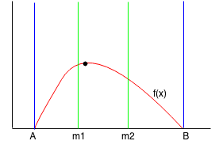

# Ternary search
y = f(x)-ийн хамгийн их(бага) утгыг олдог алгоритм.

Binary search- тэй төстэй ч дараах шинж чанар нь өөр.
* f(x) нь эрс өсөөд(буураад) хамгийн их утгаа авсны дараа эрс буурдаг(өсдөг).
* боломжит утгын хэсгийг 2 биш 3н тэнцүү хэсэгт хуваана.



Алгоритм:
1. [A,B] хооронд max утга нь байгаа гэж үзье.
2. [A,m1], [m1,m2], [m2,B] гэсэн 3н тэнцүү хэсэгт хуваана.
3. f(m1)==f(m2) байвал A=m1,B=m2 болгоод 1.дэх үйлдлээс дахин давтана.
4. f(m1)>f(m2) байвал [m2,B] гэсэн хэсэг нь эрс буурах хэсэг тул max утга энэ хэсэгт байхгүй. B=m2 болгоод 1.дэх үйлдлээс дахин давтана.
5. f(m1)<f(m2) байвал [A,m1] гэсэн хэсэг нь эрс өсөх хэсэг тул max утга энэ хэсэгт байхгүй. A=m1 болгоод 1.дэх үйлдлээс дахин давтана.

Жишээ бодлого: Эрс өсөөд, дараа нь эрс буурдаг n урттай дараалал өгөгдөнө. Хамгийн их элементийн утгыг ол.

```cpp
// arr: эрс өсөөд, дараа нь эрс буурдаг n урттай дараалал
int l = 0, r = n - 1;
while(r - l > 2){
    int m1 = l + (r - l) / 3;
    int m2 = r - (r - l) / 3;
    if(arr[m1] < arr[m2]) l = m1 + 1;  // max нь m1-ээс баруун талд
    else r = m2 - 1;                    // max нь m2-оос зүүн талд
}
// үлдсэн 3 хүртэлх элементээс хамгийн томыг нь авна
int ans = arr[l];
for(int i = l; i <= r; i++) ans = max(ans, arr[i]);
cout << ans << "\n";
```

Бодлого5(1100): https://codeforces.com/problemset/problem/1288/A

Бодлого6(1600): https://codeforces.com/problemset/problem/1730/B

